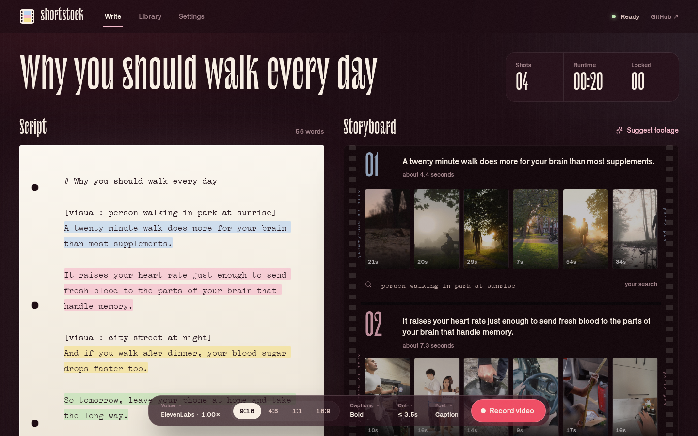
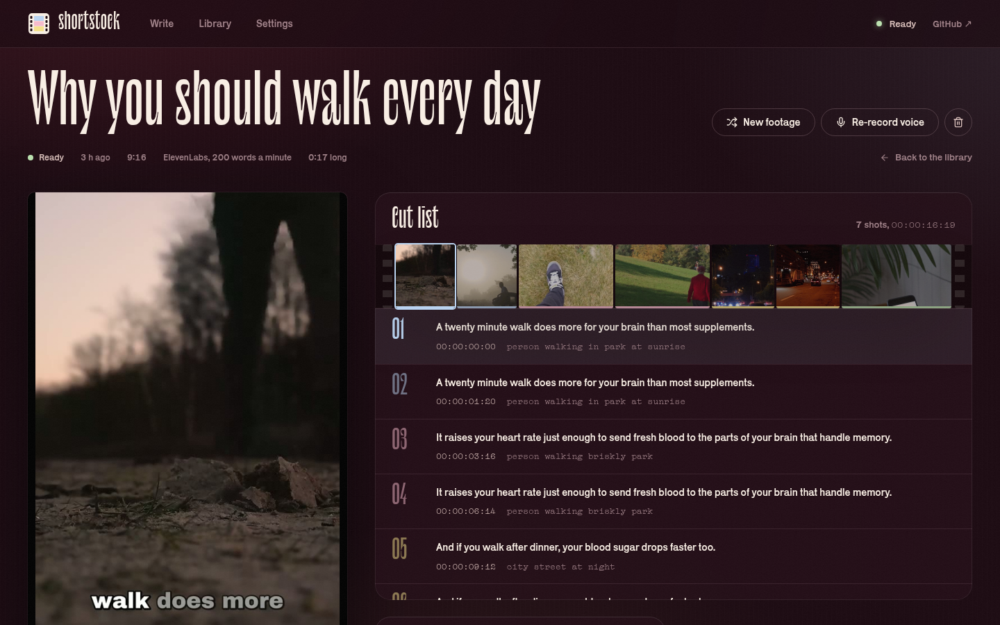

<div align="center">

# shortstock

**Free, open-source faceless video generator. Turn a script into a narrated stock-footage video for TikTok, Instagram Reels, YouTube Shorts and YouTube.**

Paste a script and watch it turn into a storyboard: every sentence becomes a shot with real Pexels footage to pick from. Then record it with an ElevenLabs or Fish Audio voice and get a finished video cut to the words, with animated captions.

An open-source, self-hosted alternative to InVideo AI, Pictory and Fliki. Bring your own keys, no watermark, no subscription, with a web app and a JSON CLI for AI agents.

[](LICENSE)
[](pyproject.toml)
[](https://github.com/T3-Venture-Labs-Limited/short-stock/actions/workflows/ci.yml)
[](#quick-start)

[Quick start](#quick-start) · [Features](#features) · [The storyboard](#the-storyboard) · [CLI and AI agents](#cli-and-ai-agents) · [FAQ](#faq) · [Contributing](#contributing)



</div>

## What is shortstock?

shortstock is an open-source tool that turns a written script into a narrated video built from stock footage, the format used by "faceless" YouTube and TikTok channels, explainers and short-form ads. It reads your script with a text-to-speech voice, uses the word timings that come back to cut a new stock clip for every line, searches Pexels for footage that matches what is being said, and burns in animated captions. You get an MP4 ready to post.

You bring the script. Most people write it with their own AI assistant, which already knows the product or topic, then paste it in or hand it to shortstock's CLI.

Sibling project: [clipyyy](https://github.com/T3-Venture-Labs-Limited/clipyyy) turns long videos into short clips.

### Why shortstock

| | shortstock | Typical hosted faceless video tools |
|---|---|---|
| Price | Free. You pay your voice provider per use, or nothing with Fish Audio's free model | Monthly subscription with credit limits |
| Watermark | Never | On free plans |
| Footage before you pay | Live storyboard of real clips for every sentence | Usually generated after you commit |
| Voices | Any ElevenLabs or Fish Audio voice, including your own clones | The tool's own voice list |
| Automation | JSON CLI and an agent skill file | Web app only, or a paid API |
| Your data | Runs on your machine | Uploaded to their cloud |

## Features

- **Two voice providers.** [ElevenLabs](https://elevenlabs.io) and [Fish Audio](https://fish.audio), both with word-level timestamps, so cuts and captions land on the words. Pick any voice from your library, or search Fish Audio's public library.
- **A live storyboard.** As you write, every sentence becomes a shot card with real Pexels clips. Hover to preview, click to lock a clip, edit the search inline, or let an optional AI suggest searches for every line. All before you pay for a voice.
- **Footage that matches the words.** Choose a shot yourself with `[visual: city skyline at night]`, lock an exact clip with `[clip: 123456]`, let AI write the search, or fall back to keywords.
- **Cut on the voice.** Shots change between sentences and every few seconds within long ones. You set the longest shot.
- **Animated captions.** Word-by-word highlighted subtitles in three styles.
- **Any format.** 9:16 for Shorts, Reels and TikTok, 4:5 and 1:1 for feeds, 16:9 for YouTube.
- **Background music.** Add a track and it plays quietly, ducking under the voice.
- **Stock bank.** Downloaded clips are cached and reused, with photographer credits saved for every video.
- **Resumable.** Each step is saved. "New footage" re-picks clips without paying for the voiceover again.
- **Optional auto-posting** to TikTok, Instagram, YouTube, Facebook and more through [Buffer](https://buffer.com).
- **Web app and CLI**, both local. No watermark and no limits. MIT licensed.

## Quick start

You need an [ElevenLabs](https://elevenlabs.io/app/settings/api-keys) or [Fish Audio](https://fish.audio/app/api-keys) API key, and a free [Pexels](https://www.pexels.com/api/) key. Fish Audio's **S2.1 Pro Free** model (Settings → Voice) makes videos without any voice credit.

### Docker

```bash
git clone https://github.com/T3-Venture-Labs-Limited/short-stock
cd short-stock
docker compose up -d
```

Open http://localhost:8000, add your keys under **Settings**, paste a script and click **Record video**.

### From source

Requires Python 3.11+, Node 22+, [uv](https://docs.astral.sh/uv/) and ffmpeg with libass (Linux distribution packages include it; on a Mac see [below](#macos)).

```bash
git clone https://github.com/T3-Venture-Labs-Limited/short-stock
cd short-stock
uv sync
npm --prefix frontend ci && npm --prefix frontend run build
uv run shortstock serve
```

Run `uv run shortstock doctor` to check your setup.

### macOS

shortstock runs on Apple Silicon and Intel Macs. Install the tools with [Homebrew](https://brew.sh), then follow the steps above:

```bash
brew install ffmpeg-full uv node
```

- **Use `ffmpeg-full`, not `ffmpeg`.** Homebrew's standard `ffmpeg` is built without libass, so it can't draw captions. `ffmpeg-full` can. If you already have Homebrew's `ffmpeg`, `ffmpeg-full` is installed beside it rather than replacing it; shortstock finds it either way. `uv run shortstock doctor` shows which ffmpeg is used, and `SHORTSTOCK_FFMPEG` points it at another one.
- **Docker** works too, with Docker Desktop on both Apple Silicon and Intel.

## The storyboard

The web app has two halves: your script on the left, a storyboard on the right that updates as you type. Each sentence is a shot with its footage search and the clips that search finds. Choices you make in the storyboard are written back into the script as directions, so the script is always the full recipe for the video, whether it comes from the web app, the CLI or an AI agent.

Plain text or Markdown works. Each sentence becomes at least one shot.

```markdown
# Why you should walk every day

[visual: person walking in park at sunrise]
A twenty minute walk does more for your brain than most supplements.

It raises your heart rate just enough to send fresh blood to the parts of your brain that handle memory.

[visual: city street at night]
And if you walk after dinner, your blood sugar drops faster too.
```

- **Headings** are not read aloud; the first one becomes the video title.
- **`[visual: …]`** sets the footage search for the next sentence. Concrete, filmable terms work best.
- **`[clip: 123456]`** locks a specific Pexels video for the next sentence. Find ids in the storyboard or with `shortstock footage "<search>"`.
- Sentences without a hint get a search written by an LLM if you add an OpenRouter key, or keywords from the sentence if you don't.
- Other text in square brackets, such as `[pause]`, is not read aloud.

## CLI and AI agents

Every command accepts `--json`, so scripts and coding agents can make videos directly.

```bash
shortstock config set elevenlabs_api_key sk_...
shortstock config set pexels_api_key ...

# Make a vertical video and copy it to ./videos
shortstock make script.md --out ./videos --json

# A landscape YouTube video with a Fish Audio voice and music
shortstock make script.md --voice fish:<voice-id> --aspect 16:9 --music track.mp3

# Pipe a script from another tool
cat script.md | shortstock make - --json

shortstock footage "ocean waves"              # find clips to lock with [clip: id]
shortstock voices --provider elevenlabs      # list voices
shortstock voices --provider fish --search narrator
shortstock retry <run-id> --from footage      # new footage, same voiceover
shortstock publish <video-id> --channel <buffer-channel-id> --mode queue
```

Example output:

```json
{
  "run_id": "6e3c1f531638",
  "status": "completed",
  "title": "Why you should walk every day",
  "video": { "id": "3257ab26aedd", "file": "/home/you/videos/why-you-should-walk-every-day.mp4",
             "duration_seconds": 18.8, "width": 1080, "height": 1920 },
  "voice": { "duration_seconds": 18.76, "timed_ratio": 1.0, "wpm": 198.3, "provider": "ElevenLabs" },
  "shots": 8,
  "credits": [{ "id": 20488159, "author": "Matthias Groeneveld", "url": "https://www.pexels.com/video/..." }]
}
```



[`skills/shortstock/SKILL.md`](skills/shortstock/SKILL.md) is a ready-made skill file for agents, and [`AGENTS.md`](AGENTS.md) maps the codebase.

## How it works

| Step | What happens |
|---|---|
| 1. Voiceover | ElevenLabs or Fish Audio reads the script and returns the audio plus the start and end time of every word. Long scripts are split and joined. |
| 2. Plan shots | Sentences are matched to the spoken words, cut halfway through the pauses, and split into shots no longer than your limit. Each sentence gets a footage search. |
| 3. Find footage | Locked clips are used as chosen; every other shot gets a different Pexels clip in the right orientation. Clips are downloaded once and cached. |
| 4. Render | ffmpeg crops each clip to the frame, joins them, adds the voice and optional ducked music, and burns in captions. |

## Settings

Add keys in the web app under **Settings**, with `shortstock config set <key> <value>`, or with environment variables. Values saved in the app take priority.

| Setting | Environment variable | Used for |
|---|---|---|
| `tts_provider` | `SHORTSTOCK_TTS_PROVIDER` | `elevenlabs` (default) or `fish` |
| `elevenlabs_api_key`, `elevenlabs_voice_id`, `elevenlabs_model` | `ELEVENLABS_API_KEY`, `ELEVENLABS_VOICE_ID`, `ELEVENLABS_MODEL_ID` | ElevenLabs voices (default model `eleven_multilingual_v2`) |
| `fish_api_key`, `fish_voice_id`, `fish_model` | `FISH_API_KEY`, `FISH_VOICE_ID`, `FISH_MODEL` | Fish Audio voices (default model `s2.1-pro`; `s2.1-pro-free` needs no credit) |
| `pexels_api_key` | `PEXELS_API_KEY` | Stock footage (required) |
| `openrouter_api_key`, `llm_model` | `OPENROUTER_API_KEY`, `SHORTSTOCK_LLM_MODEL` | Optional: better footage searches |
| `buffer_api_key`, `s3_*` | `BUFFER_API_KEY`, `SHORTSTOCK_S3_*` | Optional: auto-posting through Buffer |

Data, the stock cache and the database live in `SHORTSTOCK_HOME` (default `~/.shortstock`).

## FAQ

**Is shortstock free?**
Yes, it is free and open source under the MIT licence. You pay only your voice provider for the voiceover; Pexels footage is free.

**What is a faceless video generator?**
A tool that makes videos without anyone on camera: a voiceover over stock footage or visuals, with captions. It is common for YouTube automation channels, TikTok explainers and product ads. shortstock is an open-source, self-hosted one.

**Can I see the footage before I pay for the voice?**
Yes. The storyboard searches Pexels as you write and shows the clips for every sentence. Only Record video calls your voice provider.

**Can it write the script for me?**
No, on purpose. Paste a script from your own AI assistant or writer. Agents can generate a script and call `shortstock make - --json` in one step.

**ElevenLabs or Fish Audio?**
Both work and both return word timings. ElevenLabs has a large voice library and strong multilingual models; Fish Audio is cheaper, has a large public voice library, and offers a free model. Check each voice's licence before commercial use.

**Can I use the footage commercially?**
Pexels videos are free to use under the [Pexels licence](https://www.pexels.com/license/). shortstock saves the photographer credits for every video.

**Does it work on a Mac?**
Yes, on Apple Silicon and Intel. Install `ffmpeg-full` from Homebrew rather than `ffmpeg`; see [macOS](#macos).

**Which languages are supported?**
Any language your voice provider supports. Captions follow the spoken words. Footage searches work best in English, so use English `[visual: …]` hints for other languages.

## Privacy and security

- Your script is sent to your voice provider, and sentences without hints go to OpenRouter if you configured it. Footage searches go to Pexels.
- Keys are stored in the local SQLite database. Protect the data folder.
- The web app has no login and listens on localhost by default. Do not expose it to the internet without authentication in front of it.

## Development

```bash
uv sync
uv run pytest -q                  # backend tests (need ffmpeg)
uv run ruff check src tests
npm --prefix frontend test        # frontend tests
npm --prefix frontend run dev     # UI on :5173, proxies /api to :8000
uv run shortstock serve           # API and worker on :8000
```

## Contributing

Contributions are welcome through pull requests. Fork the repository, make your change on a branch, and open a pull request against `main`; a maintainer reviews and merges it. Read [CONTRIBUTING.md](CONTRIBUTING.md) first. Bugs and ideas go in [issues](https://github.com/T3-Venture-Labs-Limited/short-stock/issues).

You are also free to fork shortstock and make it your own under the MIT licence.

If shortstock saves you a subscription, a star helps other people find it.

## Credits

- Captions use [Archivo Black](https://github.com/Omnibus-Type/ArchivoBlack) (SIL Open Font License, included).
- The interface is set in [Le Murmure](https://velvetyne.fr/fonts/le-murmure/) by Jérémy Landes, [Compagnon](https://velvetyne.fr/fonts/compagnon/) by Juliette Duhé, Léa Pradine, Valentin Papon, Chloé Lozano and Sébastien Riollier, and [Karrik](https://velvetyne.fr/fonts/karrik/) by Jean-Baptiste Morizot and Lucas Le Bihan, all from the [Velvetyne](https://velvetyne.fr) foundry (SIL Open Font License, licences in `frontend/src/fonts`).
- Footage from [Pexels](https://www.pexels.com). Voices from [ElevenLabs](https://elevenlabs.io) and [Fish Audio](https://fish.audio).
- Built on [ffmpeg](https://ffmpeg.org) and [FastAPI](https://fastapi.tiangolo.com).

## License

[MIT](LICENSE)
